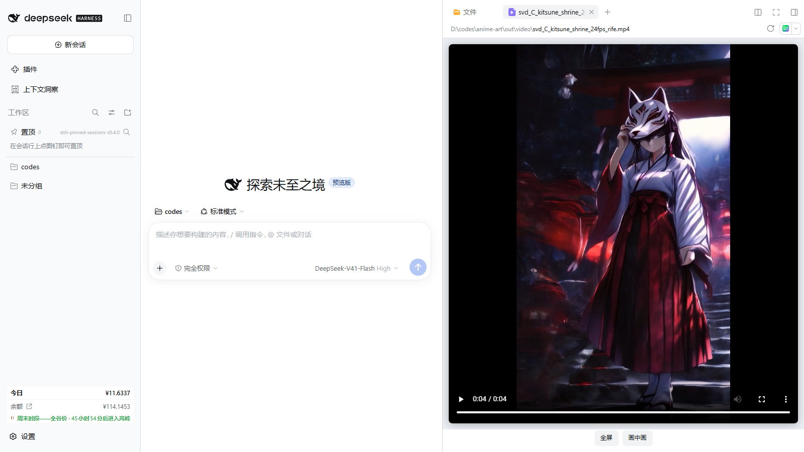
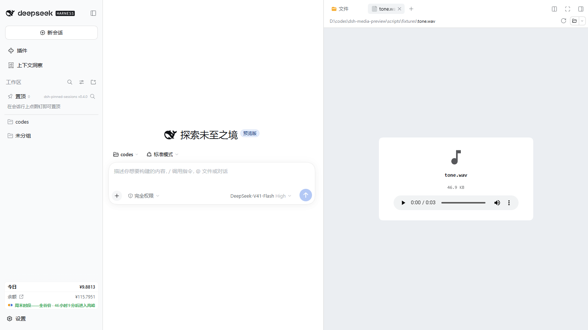

# dsh-preview-media

给 [DeepSeek Harness](https://github.com/deepseek-ai/deepseek-harness) 加视频 / 音频预览：在右侧栏的文档预览里直接播放 `mp4`、`mov`、`mkv`、`webm` 以及 `mp3`、`flac`、`wav`，不再出现「该格式文件暂时无法预览」。

中文（本文件）| [English](README.md)

## 为什么需要它

内置预览为文本、代码、Markdown、图片、PDF、HTML、Office、表格都注册了渲染器，却把视频 / 音频后缀列进「已知二进制容器、无渲染器」清单——所以打开视频只显示一个图标和一行字。本插件接管这些后缀，画出浏览器原生播放器，数据来自一条**带鉴权、支持 HTTP `Range` 的流式路由**：能拖进度、2 GB 的文件也不会整个读进内存或对话上下文。

## 安装

```sh
dsh plugin --profile <profile> add dsh-preview-media
```

然后重启桌面端（profile patch 在启动时读取）。无需任何配置，默认后缀已覆盖常见格式。

验证是否生效：从「文件」标签页打开任意 `.mp4`，右侧栏应出现播放器而不是「暂时无法预览」。




## 它做了什么

- **渲染器** — 注册两个文档预览实现：`dsh-preview-media/video`（视频后缀）与 `dsh-preview-media/audio`（音频后缀），优先级 `extension`，`loading: 'renderer'`，后缀同时声明为二进制，因此不再提供「纯文本」兜底。
- **播放器** — 原生 `<video>` / `<audio>` 元素，带浏览器自带控件。视频用 `object-fit: contain` 装进自适应框里，竖屏、横屏都一屏完整显示（多出来的是黑边），不会撑出预览区；下方有 **倍速**（1× → 1.25× → 1.5× → 1.75× → 2× → 0.5× → 0.75× 循环切换）、**循环**，视频另有 **全屏** 与 **画中画**。倍速/循环对音频同样生效，并按浏览器记住选择。音频显示文件卡片（文件名、大小、播放器）。body 会把 `loaded` / `failed` 回报给预览所有者，标签页的加载态才能收尾。
- **流式路由** — Host 端 `GET|HEAD /api/preview/media?path=<绝对路径>`：`200` + `Accept-Ranges: bytes`；`206` + `Content-Range`（单窗口）；`416` + `Content-Range: bytes */size`；`HEAD` 只回头。实现上每次通过 `ctx.fs.readByteRange` 读一块（`chunkBytes`，默认 1 MiB），内存占用恒定。
- **桌面端拖动进度** — 桌面端页面来自 `dsh-app://app`，其余请求都经 `protocol.handle` 代理。Chromium 的媒体栈**无法对自定义协议处理器产生的响应做 seek**（`video.seekable` 直接退化成 `[0, 0]`），所以在桌面端会出现「能播、但一拖进度就弹回开头」。因此 Host 另开一个 127.0.0.1 的临时端口，并通过 `GET /api/preview/media?discover=1` 把带一次性能力令牌的地址交给浏览器半：在桌面外壳里播放器直接连这个回环源，走真正的 HTTP `Range`，拖动即可定位。普通浏览器里仍用原来的鉴权路由。
- **鉴权** — 路由挂在 `/api/` 下，连接服务的 Host/Origin 防护与浏览器会话 cookie 校验在进入 handler 之前执行，跨站页面无法借它读本地文件。回环监听只绑 `127.0.0.1`，且每个请求必须带上本次启动随机生成的令牌（在路径里），否则只回一个 `404`；字节仍经组合后的 `fs` provider 读取，文件系统策略与 `/api` 路由完全一致。

## 配置

配置项在 `preview-media` 这一行（设置 → 插件，或 profile patch）。每个键都有代码侧默认值，只写一部分也合法。

| 键 | 默认值 | 含义 |
|---|---|---|
| `enabled` | `true` | 是否挂载路由。关掉后渲染器仍在，但不传字节（`503`）。 |
| `routePath` | `/api/preview/media` | 路由路径。必须以 `/api/` 开头，否则回退到默认值，保证鉴权防线不失效。 |
| `loopback` | `true` | 是否同时开一个带令牌的 `127.0.0.1` 回环源。**桌面端能拖进度靠的就是它**；关掉后只剩鉴权路由，桌面端能播但不能 seek。 |
| `debug` | `false` | 把播放器与回环源的诊断事件逐行写进 `$DSH_HOME/preview-media-debug.log`。只有排查播放问题时才需要打开。 |
| `maxBytes` | `2147483648`（2 GiB） | 允许流式传输的最大文件，更大的回 `413`。 |
| `chunkBytes` | `1048576` | 每次范围读的字节数。 |
| `videoExtensions` | `mp4, m4v, mov, webm, ogv, ogg, mkv, avi, wmv, flv, 3gp, ts, m2ts, mts` | 视频播放器接管的后缀。 |
| `audioExtensions` | `mp3, wav, flac, m4a, aac, oga, opus, weba, wma, aiff, aif` | 音频播放器接管的后缀。 |

浏览器半在 `lib/client.js` 里另存一份同样的后缀表，改一侧要同步改另一侧。路由路径由 Host 以 `__DSH_PREVIEW_MEDIA_CONFIG__` 注入页面，配置值不会和播放器用的 URL 走偏。

## 能播什么

能不能解码取决于浏览器本身，不取决于本插件。Chromium / Electron 能播 MP4（H.264/AAC）、WebM（VP8/VP9/Opus）、Ogg 以及多数音频格式；**Matroska（`.mkv`）与 AVI 在 Chromium 里通常解不出来**，此时播放器会显示「浏览器不支持这个编码」，预览头部的「打开」仍可交给系统播放器。要可靠播放，先重封装成 MP4/WebM。

## 结构

```
lib/index.js    Host 入口：name / inject / Config / apply（路由 + 回环源 + 索引注入）
lib/config.js   默认值与归一化，不 import 宿主包（可单测）
lib/schema.js   schemastery Config，供 loader 与设置页
lib/range.js    HTTP Range 解析，纯函数
lib/mime.js     后缀 → media type
lib/route.js    带鉴权的流式 handler（fetch 形状、分块）
lib/loopback.js 带能力令牌的 127.0.0.1 媒体源（node:http，支持 Range）
lib/client.js   浏览器 bundle：渲染器、body、样式、文案
test/           node --test：range、config、route、回环源、适配层挂载、客户端 bundle
scripts/        无头浏览器 E2E 与 HTTP 探针
```

浏览器半是手写的 module-loader bundle（`window.__ModuleLoader__.load({ id, factory })`），只向模块表要 `react` 与 `react/jsx-runtime`，因此既不需要构建链，也不可能和宿主的 React 副本走偏。

## 开发

```sh
node --test test/*.test.js
```

端到端：起一个装了本插件的宿主，然后

```sh
node scripts/e2e-browser.mjs --base http://127.0.0.1:<port> --token <token> --video "<视频绝对路径>"
```

本机 Chromium 版本不匹配时用 `E2E_BROWSER_CHANNEL=msedge` 走系统 Edge。

拖动进度另有专项检查（含桌面端传输形态）：

```sh
node scripts/e2e-seek.mjs --base http://127.0.0.1:<port> --token <token> --video "<视频绝对路径>" --simulate-desktop
```

## 已知限制

- 一次只处理一个字节窗口；多窗口 `Range` 头回 `416`（浏览器对媒体元素只会要一个窗口）。
- `.mkv`、`.avi`、`.wmv`、`.flv` 会被接管并列出，但 Chromium 解不了，插件显示播放器的错误态而不是假装能播。
- 没有自建播放列表、字幕轨、倍速控件——这些交给原生控件。
- 若部署环境封了回环端口（防火墙 / 策略），播放器会自动退回鉴权路由：文件照样能播，但桌面端又回到「拖不动」的状态。这是 Electron 的已知限制（[electron#38749](https://github.com/electron/electron/issues/38749)、[electron#51442](https://github.com/electron/electron/issues/51442)），不是路由能解决的。

## 许可

MIT
